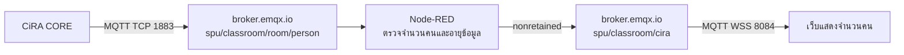

# CiRA CORE → Node-RED → เว็บ Smart Classroom

Flow นี้ใช้ MQTT ตามค่าที่ผู้ใช้ระบุ และส่งเฉพาะข้อมูลจำนวนคน เว็บยังรับอุณหภูมิ ความชื้น สถานะ ESP32 และส่งคำสั่งแอร์ตามเส้นทางเดิม



## ค่าที่ตั้งไว้แล้ว

| ส่วน | ค่า |
|---|---|
| MQTT Broker | `broker.emqx.io` |
| พอร์ต CiRA / Node-RED | `1883` |
| Topic จาก CiRA | `spu/classroom/room/person` |
| Payload จาก CiRA | `{"total_people":2}` |
| Topic ส่งเข้าเว็บ | `spu/classroom/cira` |
| MQTT URL ในเว็บ | `wss://broker.emqx.io:8084/mqtt` |
| QoS / retain | `0` / `false` |

## เปิดบนเครื่องนี้

เครื่องนี้มี Node-RED ติดตั้งแล้ว จากโฟลเดอร์โปรเจกต์รัน:

```sh
npm run node-red:start
```

เปิด <http://localhost:1880> จะพบแท็บ **CiRA CORE → Classroom Web** คำสั่งนี้ใช้ข้อมูล runtime ใน `node-red/runtime/` แยกจาก `~/.node-red/flows.json` เดิม การแก้ผ่าน editor จะถูกเก็บไว้เมื่อเปิดครั้งถัดไป หยุดด้วย Ctrl-C ใน terminal ที่เปิดไว้ เปิดเว็บแยกด้วย `npm start` ที่ <http://localhost:3000>

ตัว editor ฟังเฉพาะ localhost ส่วน CiRA CORE จะส่งจากเครื่องอื่นได้ผ่าน MQTT broker เดียวกัน จึงไม่ต้องเปิดพอร์ต editor ออกอินเทอร์เน็ต

## ตั้งค่าที่ CiRA CORE

ที่ MQTT Publish ซึ่งส่งผลนับคน ให้ใช้ Broker, Port และ Topic ในตารางข้างต้น ส่งข้อความ JSON เช่น:

```json
{"total_people":2}
```

ส่งทุกประมาณ **1–5 วินาที** แม้จำนวนคนไม่เปลี่ยน เมื่อไม่พบคนให้ส่ง `{"total_people":0}` และตั้ง **retain=false** หากส่งเฉพาะตอนจำนวนเปลี่ยน เว็บจะถือว่าข้อมูลเก่าหลัง 30 วินาที การขาดข้อมูลกล้องจะไม่ถูกแปลงเป็นห้องว่าง

ถ้ามีเวลาจับภาพ ส่ง `timestamp` เป็น epoch มิลลิวินาที หรือ ISO พร้อมเขตเวลาได้ หากไม่มี timestamp Node-RED จะใช้เวลาที่รับข้อความเป็นจุดเริ่มต้น ความสดก่อนถึง bridge จึงตรวจได้เฉพาะเมื่อ CiRA แนบเวลามาด้วย

ตัวอย่างข้อความที่ Node-RED ส่งเข้าเว็บ:

```json
{
  "total_people": 2,
  "source": "cira-core",
  "timestamp": 1794470400000,
  "received_at": "2026-11-12T08:00:00.000Z"
}
```

ค่าประทับเวลาในตัวอย่างเป็นเพียงรูปแบบข้อมูล Node-RED จะสร้างค่าปัจจุบันให้เอง

## ตรวจว่าทำงาน

1. MQTT input ขึ้น `connected` หมายถึงเชื่อม broker ได้
2. Function **ตรวจข้อมูล CiRA + freshness** ขึ้น `CiRA: 2 คน` เมื่อได้รับข้อมูลจริงล่าสุด และดู `cira_forwarded` ใน Debug ได้
3. เว็บตั้ง Topic จำนวนคน CiRA เป็น `spu/classroom/cira` แล้วช่องผู้เรียนจะแสดง 2 คน
4. เมื่อไม่มีข้อมูลใหม่เกิน 30 วินาที Function จะแจ้งรอข้อมูล และเว็บแสดง `—` แทนการใช้ค่าเก่าต่อ

ปุ่ม **ทดสอบ 2 คน • ไม่ส่ง MQTT** ใช้ตรวจรูปแบบและแสดงผลใน Debug กับ Logs ไม่ส่งจำนวนคนจำลองไปยังช่องจำนวนคน และไม่ทำให้สถานะกล้องดูเหมือนออนไลน์

## ดู Log ในเว็บ

เปิดส่วน **บันทึกการทำงาน (Logs)** ในเว็บเพื่อดูเหตุการณ์จาก CiRA CORE ตามลำดับ:

1. **รับผลตรวจจับ**: Node-RED ได้รับข้อความจากกล้องผ่าน MQTT
2. **ตรวจและสรุปจำนวนคน**: ตรวจรูปแบบและความสด แล้วใช้จำนวนคนที่ CiRA ส่งมา หรือนับจากรายการตรวจจับเมื่อมีรายการแทนตัวเลข
3. **ส่งต่อ MQTT**: ข้อมูลผ่านการตรวจและถูกส่งไปยังโหนด MQTT output แล้ว สถานะนี้ไม่ยืนยันว่า broker หรือเว็บได้รับข้อความ

แต่ละชุดเหตุการณ์มีรหัสเดียวกันสำหรับเทียบผล และบอกว่าเวลาเป็นค่าที่ CiRA แนบมาหรือเวลาที่ Node-RED รับข้อความ เวลาประมวลผลที่แสดงเป็นเวลาตรวจข้อมูลใน Node-RED ข้อความผิดรูปแบบ ข้อมูลเก่า และช่วงที่ไม่มีข้อมูลใหม่จะแสดงแยกกัน การกดปุ่มทดสอบมีเหตุการณ์ของตัวเอง

หน้าเว็บอ่านข้อมูลผ่านเซิร์ฟเวอร์ของโปรเจกต์ เซิร์ฟเวอร์อ่าน `GET http://127.0.0.1:1880/cira-observability` จาก Node-RED จุดอ่านนี้รับเฉพาะการเชื่อมต่อจาก localhost และไม่ส่ง Log ออก MQTT เก็บล่าสุดไม่เกิน 60 เหตุการณ์ในหน่วยความจำ เลือกแสดงตัวอย่างของข้อมูลที่ผ่านและที่ถูกปฏิเสธอย่างละไม่เกินหนึ่งชุดต่อวินาที ยอดรวมยังนับทุกข้อความ และเริ่มนับใหม่เมื่อเริ่ม flow ใหม่ ไม่มีการเก็บภาพ ข้อมูลดิบ หรือข้อมูลเข้าใช้ broker

## นำไปใช้กับ Node-RED ที่มีอยู่

ไฟล์นำเข้าคือ `../node_red_cira_bridge_flow.json` ใช้เมนู Import → เลือกไฟล์ → Import → Deploy เปิด bridge ชุดเดียวต่อห้อง ไม่เปิดสำเนาที่นำเข้าและ runtime ของโปรเจกต์พร้อมกัน

หน้าเว็บส่งคำสั่งควบคุมแอร์ตรงไปยัง ESP32 ส่วนการตั้งเวลาทำงานที่เซิร์ฟเวอร์ Flow CiRA นี้ส่งเฉพาะจำนวนคนผ่าน MQTT และให้เซิร์ฟเวอร์อ่านผลรวมท่าทางผ่าน HTTP ภายในเครื่อง ไม่มี MQTT output ไปที่ `spu/classroom/remote/air` และไม่สั่งเปิด–ปิดแอร์

## เพิ่มผลจำแนกท่าทางจากกล้อง

ดู [วิธีต่อ CiRA และตรวจคำแนะนำอุณหภูมิ](../CIRA_ACTIVITY.md) สำหรับรูปแบบจุดข้อต่อ ตัวแปลง และตัวอย่างการทดสอบ

ให้เครื่องที่รับผล Pose จาก CiRA ส่ง `POST http://127.0.0.1:1880/cira-pose-frame` เป็น JSON UTF‑8 โดยมี `Content-Length` และขนาดไม่เกิน 128 KiB (ไม่บีบอัดและไม่ส่งแบบ chunked) จุดรับนี้จำกัดที่ localhost ถ้า CiRA ทำงานคนละเครื่อง ให้ตั้งช่องทางเชื่อมต่อส่วนตัวไปยัง localhost ของเครื่องเซิร์ฟเวอร์ก่อน และคงเส้นทาง MQTT เดิมไว้สำหรับจำนวนคน หลักฐานท่าทางและ keypoints ไม่ผ่าน broker สาธารณะ

ข้อมูลแต่ละเฟรมใช้ `{captured_at, width, height, people}` โดย `captured_at` เป็น Unix epoch มิลลิวินาทีที่เพิ่มขึ้นและไม่ล่วงหน้า ขนาดภาพเป็นจำนวนเต็ม 16–8192 px อัตราส่วนกว้าง/สูงระหว่าง 1:4 และ 4:1 ส่วน `people` มีได้ไม่เกิน 64 คน แต่ละคนใช้ `{id, keypoints}` โดย `id` คือรหัสติดตามชั่วคราว และ `keypoints` เรียงตาม COCO 17 จุด แต่ละจุดใช้ `{x,y,score}` ค่า 0–1; จุดที่ถูกบังให้ `score:0` และส่ง `people:[]` เฉพาะเมื่อโมเดลยืนยันว่าเฟรมนั้นไม่พบคน

ใช้กล้องนิ่งและส่งราว 8–15 เฟรม/วินาทีโดยรักษารหัสติดตามเดิม การแยกเดิน/วิ่งต้องมีข้อมูลต่อเนื่องหลายเฟรม ผลที่หลักฐานไม่พอจะเป็น `unknown` และข้อมูลหายประมาณ 5 วินาทีจะแสดงว่าไม่มีข้อมูลสด เซิร์ฟเวอร์อ่าน `GET http://127.0.0.1:1880/cira-activity` ซึ่งส่งเฉพาะสถานะและ **ผลรวม** `seated`, `standing`, `walking`, `running`, `unknown` พร้อม Log ย้อนหลังสูงสุด 20 รายการ ไม่มีภาพ จุดร่างกาย หรือรหัสบุคคลในผลตอบกลับ สถานะที่ใช้ติดตามอยู่ในหน่วยความจำและถูกล้างหลังข้อมูลหมดอายุ

## ปรับแต่งและสร้าง flow ใหม่

แก้ Topic รับที่ MQTT input และแก้ Broker ที่ MQTT configuration หากต้องเปลี่ยนการเชื่อมต่อ สำหรับค่าต่อไปนี้แก้ได้ใน Environment ของแท็บ:

| ค่า | เริ่มต้น | ความหมาย |
|---|---|---|
| `CIRA_OUTPUT_TOPIC` | `spu/classroom/cira` | Topic จำนวนคนของเว็บ ต้องต่างจาก Topic รับ |
| `CIRA_MAX_AGE_SECONDS` | `30` | อายุข้อมูลกล้องที่ยอมรับ |
| `CIRA_MIN_CONFIDENCE` | `0.5` | ใช้เฉพาะเมื่อส่งรายการตรวจจับแทน count |

ตัวตรวจรองรับตัวเลข, `total_people`, `people`, `person_count`, `counts.person` รวมถึงรายการ `detections` / `objects` ที่ระบุชื่อคลาสชัดเจน ข้อมูลผิดรูปแบบ ค่าติดลบ/ทศนิยม ค่าขัดแย้ง ข้อความ retained และข้อมูลเก่าจะถูกละไว้ พร้อมเหตุผลใน Debug ส่วนเว็บรับค่าที่ผ่านตรวจเป็น canonical `total_people`

หลังแก้ไฟล์ต้นฉบับ `normalize-cira.js`, `cira-observability.js`, `pose-activity.js`, `cira-pose-bridge.js` หรือ `build-flow.js` รัน:

```sh
npm run node-red:build
```

คำสั่งนี้สร้างไฟล์นำเข้าใหม่ แต่ไม่ทับการแก้ไขที่เก็บใน runtime หากรัน CiRA flow รุ่นเก่า ให้สำรองแท็บเดิมและจดค่า Broker, Topic และ Environment ที่แก้เอง จากนั้นใช้แท็บ CiRA รุ่นใหม่แทนแท็บเดิมและ Deploy โดยเปิดใช้งาน bridge เพียงชุดเดียว ถ้าเว็บแจ้งว่าอ่าน Log ไม่ได้ ให้ลองเปิด URL `cira-observability` บนเครื่องที่รัน Node-RED: ถ้าได้ 404 แสดงว่า flow ที่ทำงานอยู่ยังไม่มีจุดอ่าน Log รุ่นนี้

## การตรวจสอบซอฟต์แวร์

```sh
npm test
```

ชุดทดสอบครอบคลุมค่าจำนวนคนจริง/ศูนย์ รูปแบบผิด ข้อมูลเก่า/อนาคต retained การคงเวลาเก็บภาพ watchdog ที่ไม่ส่งค่าเก่าซ้ำ และการป้องกัน Topic วนกลับ รวมถึง Log ที่จำกัดขนาด แยกเวลาจากกล้องกับเวลารับ และนับทุกข้อความแม้เลือกแสดงตัวอย่าง ทดสอบ runtime Node-RED จริงกับ broker จำลองบน localhost เพิ่มเติม โดยไม่ส่งข้อความทดสอบไปที่กล้องหรืออุปกรณ์จริง

เอกสาร Node-RED: [MQTT broker](https://cookbook.nodered.org/mqtt/connect-to-broker), [นำเข้า flow](https://nodered.org/docs/user-guide/editor/workspace/import-export), [Environment variables](https://nodered.org/docs/user-guide/environment-variables)
